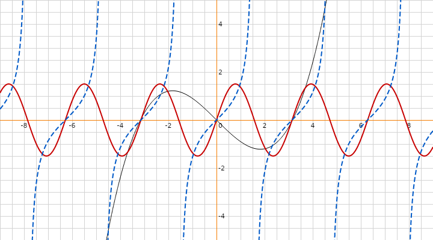
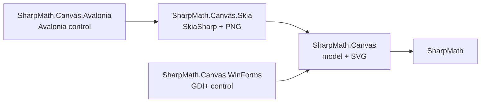
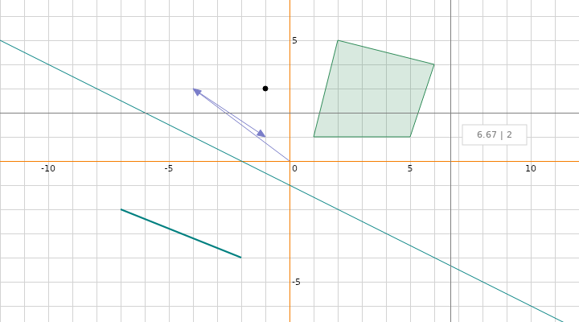

# SharpMath

SharpMath is a .NET math library: vectors, points, matrices, lines, segments and polygons, linear equation systems and
an expression parser. It also has a 2D canvas that plots functions and geometry and renders them through GDI+,
SkiaSharp or SVG, or shows them interactively in WinForms and Avalonia.



> **SharpMath 2.0** is a rewrite for .NET 10 with many breaking changes. See [CHANGELOG.md](CHANGELOG.md) for a
> migration guide from 1.x.

## Packages

| Assembly | What it contains | Dependencies | Platforms |
|---|---|---|---|
| `SharpMath` | Geometry, equations, expressions | none | all |
| `SharpMath.Canvas` | Canvas model, styles, renderer interface, SVG renderer | `SharpMath` | all |
| `SharpMath.Canvas.Skia` | SkiaSharp renderer, PNG export | `SkiaSharp` | Windows, Linux, macOS |
| `SharpMath.Canvas.WinForms` | WinForms control, GDI+ renderer | Windows Desktop | Windows |
| `SharpMath.Canvas.Avalonia` | Avalonia control | `Avalonia`, `SharpMath.Canvas.Skia` | Windows, Linux, macOS |



The packages are not published on NuGet yet. Reference the projects from source or build them with `dotnet pack`.

## Geometry

All vectors, points, matrices and lines are immutable `readonly struct`s with `System.Numerics`-style names. Equality
(`==`, `Equals`, `GetHashCode`) is exact; `ApproximatelyEquals` and all predicates such as `IsOrthogonal` or
`IsParallelTo` use the tolerances from `SharpMath.Tolerance` (absolute `1e-12`, relative `1e-9`).

```csharp
using SharpMath.Geometry;

var a = new Vector3(1, 2, 3);
var b = new Vector3(-2, 0.5, 4);
var normal = a.Cross(b).Normalize();
var angle = a.Angle(b);                          // radians
var moved = a with { Z = 0 };                    // modify a copy

var p = new Point2D(1, 2);
var q = p + new Vector2(3, 4);                   // point + vector = point
var direction = q - p;                           // point − point = vector
```

> **Column vectors.** SharpMath uses the textbook convention `v' = M · v`: write `matrix * vector`, and transformations
> compose from right to left. `T * R * S * v` scales first, then rotates, then translates. `System.Numerics` uses row
> vectors and composes the other way round.

```csharp
var model = Matrix4x4.Translation(0, 0, -5) * Matrix4x4.RotationY(Math.PI / 4) * Matrix4x4.Scaling(2);
var view = Matrix4x4.LookAt(eye: new Vector3(0, 2, 5), target: Vector3.Zero, up: Vector3.Up);
var projection = Matrix4x4.PerspectiveFieldOfView(Math.PI / 3, aspectRatio: 16.0 / 9, nearPlane: 0.1, farPlane: 100);
var clip = projection * view * model * new Vector3(1, 1, 1);   // includes the perspective divide

var m = new Matrix3x3(2, 5, 2, 3, -3, 1, 1, 4, -4);           // row-major
double det = m.Determinant;                                    // 111, closed form
if (m.TryInvert(out var inverse))
    Console.WriteLine(m * inverse);                            // ≈ identity
```

The projection is right-handed with a depth range of [0, 1]; the camera looks along −Z (`Vector3.Forward`).

For larger matrices, `MatrixMxN` offers products, transpose, determinant, inverse, rank and `Solve` via an LU
decomposition with partial pivoting. `IsSingular`, `Inverse()` and `Solve` all use the same rule: a matrix is singular
if a pivot of the LU decomposition is at most `n · ε` times its largest entry.

### Lines, segments and polygons

```csharp
// Ax + By + C = 0, also for vertical lines
var line = Line2D.FromGeneralForm(4.0 / 3, -1, 1.0 / 3);
double y = line.SolveForY(2);
var other = Line2D.FromPoints(new Point2D(1, 0), new Point2D(1, 5));   // vertical

var intersection = line.Intersect(other);
if (intersection.Kind == IntersectionKind.Point)
    Console.WriteLine(intersection.Point);

var segment = new LineSegment2D(new Point2D(0, 0), new Point2D(4, 4));
var hit = segment.Intersect(new LineSegment2D(new Point2D(0, 4), new Point2D(4, 0)));   // Point (2, 2)

var line3 = Line3D.FromPoints(new Point3D(0, 0, 0), new Point3D(1, 1, 0));
var kind = line3.Intersect(Line3D.FromPointAndDirection(new Point3D(0, 0, 3), Vector3.UnitY)).Kind;   // Skew

var polygon = new Polygon(new Point2D(0, 0), new Point2D(4, 0), new Point2D(4, 4), new Point2D(2, 1), new Point2D(0, 4));
Console.WriteLine($"{polygon.Area} {polygon.Perimeter} {polygon.Centroid} {polygon.Contains(new Point2D(1, 1))}");
```

## Linear equation systems

```csharp
using SharpMath.Equations;

// x − y + 2z = 6, 2x + 3y + 2z = 11, 3x + 2y + z = 8
var system = new LinearEquationSystem(
    new LinearEquation([1.0, -1, 2], 6),
    new LinearEquation([2.0, 3, 2], 11),
    new LinearEquation([3.0, 2, 1], 8));
double[] solution = system.Solve();   // [1, 1, 3]
```

`Solve` throws an `EquationNotSolvableException` if the system has no unique solution.

## Expressions

`MathExpression` parses an expression once and evaluates it as often as needed, without allocating.

```csharp
using SharpMath.Expressions;

double value = MathExpression.Parse("3*4^2 + sin(pi/2)").Evaluate();    // 49

var expression = MathExpression.Parse("2x^2 - 3x + 1");                 // implicit multiplication
Func<double, double> f = expression.ToFunc("x");
double y = f(1.5);

var context = new ExpressionContext()
    .AddFunction("sec", x => 1 / Math.Cos(x))
    .AddConstant("g", 9.81)
    .DeclareVariable("t");
var fall = MathExpression.Parse("g t^2 / 2", context);
double distance = fall.Evaluate("t", 3);
```

The parser supports:
- numbers like `1.5`, `.5` and `1e5`
- the operators `+ - * / % ^` and postfix `!`; `^` is right-associative, and `-2^2 = -4`
- parentheses and implicit multiplication: `2x`, `3(x+1)`, `(x+1)(x-1)`
- the functions `sin cos tan asin acos atan atan2 sinh cosh tanh sqrt abs ln lg log(x, base) log2 exp floor ceil round sign pow min max`
- the constants `pi`, `e` and `tau`

Names are case-insensitive. A sequence of letters is split by longest match against the known names, so `pix` is
`pi·x`. Two or more letters directly in front of `(` must name a function: `cot(x)` is an error unless `cot` was added
to the context. Write `x*y*(2)` or `x y(2)` for products of single-letter variables. Every syntax error is a
`ParserException` with the `Position` of the problem. Use `context.Clone()` to derive variants of a configured
context.

## Canvas



`Canvas2D` is a platform-neutral model. It holds the viewport (pan and zoom), the grid with labelled ticks, the style
and the items: functions (delegates or expression strings), vectors, points, infinite lines, segments and polygons.
Renderers implement `IDrawingContext`; hosts forward mouse input to the model and redraw when it raises `Changed`.

```csharp
using SharpMath.Canvas;
using SharpMath.Expressions;
using SharpMath.Geometry;

var canvas = new Canvas2D { ShowTrackingLines = true };
canvas.AddFunction("x^3 / 10 - x");
canvas.AddFunction("sec(x)", context: new ExpressionContext().AddFunction("sec", x => 1 / Math.Cos(x)));
canvas.AddFunction(Math.Sin, new ItemStyle(new Stroke(Color.FromRgb(200, 0, 0), Width: 2, DashStyle.Dashed)));
canvas.AddVector(new Vector2(4, 3));
canvas.AddPolygon(new Polygon(new Point2D(2, -2), new Point2D(6, -2), new Point2D(4, -5)));
canvas.Style = canvas.Style with { AxisStroke = new Stroke(Color.Black) };
```

Ways to display or export a canvas:
- **SVG**, without dependencies: `string svg = canvas.RenderSvg(800, 600);`
- **PNG** via SkiaSharp: `canvas.RenderPng(stream, 800, 600);`, or `canvas.RenderImage(...)` for an `SKImage`
- **WinForms**: place a `Canvas2DControl` on a form and use its `Canvas` property. It renders with GDI+.
- **Avalonia**: place a `Canvas2DView` in a window and use its `Canvas` property. It renders with Skia.

In both controls, drag with the left mouse button to pan and use the mouse wheel to zoom around the pointer.

## Samples

| Sample | Description |
|---|---|
| `samples/SharpMath.Samples.Canvas.WinForms` | Interactive canvas with an expression input (Windows) |
| `samples/SharpMath.Samples.Canvas.Avalonia` | The same, cross-platform |
| `samples/SharpMath.Samples.Perspective.WinForms` | A rotating wireframe cube using `LookAt` and the perspective projection (Windows) |
| `samples/SharpMath.Samples.Polygon.WinForms` | `Polygon.Contains` following the mouse pointer (Windows) |
| `samples/SharpMath.Samples.Export` | Renders PNG and SVG without UI; it generates the images in this README |

## Platform support and determinism

SharpMath targets .NET 10 and is tested on Windows, Linux and macOS. The maths uses plain `double` arithmetic without
platform-specific SIMD code. Results are therefore as reproducible as .NET's floating-point and `System.Math`
implementations: elementary arithmetic is IEEE 754 and identical everywhere, but functions such as `Math.Sin` may
differ in the last bits between platforms and runtime versions. If you need bit-exact lockstep results (e.g. for
networked games), avoid transcendental functions in the simulated state.

## Building and testing

You need the .NET 10 SDK.

```shell
dotnet build SharpMath.slnx
dotnet test --solution SharpMath.slnx

# Coverage gate (at least 90 % line coverage for SharpMath and SharpMath.Canvas), as in CI
dotnet test --project tests/SharpMath.Tests --coverage --coverage-output-format cobertura --coverage-output core.cobertura.xml --results-directory coverage
dotnet test --project tests/SharpMath.Canvas.Tests --coverage --coverage-output-format cobertura --coverage-output canvas.cobertura.xml --results-directory coverage
dotnet run eng/CheckCoverage.cs -- 90 coverage/core.cobertura.xml=SharpMath coverage/canvas.cobertura.xml=SharpMath.Canvas

# Benchmarks (results in doc/benchmarks.md)
dotnet run -c Release --project benchmarks/SharpMath.Benchmarks -- --filter "*"
```

The WinForms projects build on every platform, but their tests only run on Windows.

## Credits

Thanks to [NikxDa](https://github.com/nikxda), who wrote the original Canvas2D control, and to
[Stefan Baumann](https://github.com/stefan-baumann) and [Voon Foo](https://github.com/voonfoo) for their
contributions.

## License

SharpMath is licensed under the [MIT License](LICENSE).
